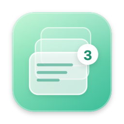
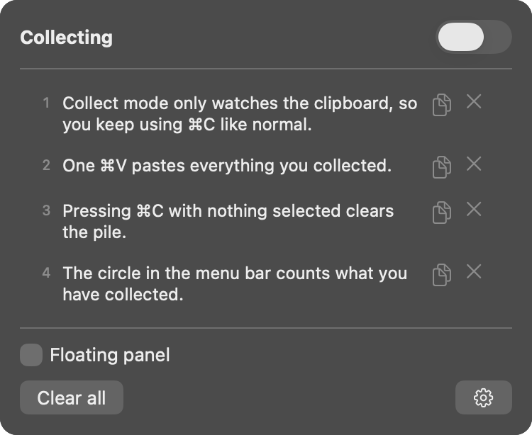

# Copy Collector



*Formerly Clip List.*

A tiny Mac menu bar app for copying several things while you read, then pasting them all at once. Turn it on, press ⌘C on each line you want to keep, and one ⌘V pastes the whole pile.



## ⬇️ [Download Copy Collector for Mac](https://github.com/hi-dad/copy-collector/releases/latest/download/CopyCollector.dmg)

Needs macOS 13 (Ventura) or newer. Works on Apple Silicon and Intel Macs. This link always gets the newest version.

## Install

1. Open the downloaded **CopyCollector.dmg**.
2. Drag **Copy Collector** onto the **Applications** folder in that window. (Don't open it from inside this window.)
3. Open **Applications** and double-click **Copy Collector**.
4. Look for the circle icon in the menu bar (top right of the screen), then turn on **Input Monitoring** (see [Permissions](#permissions)).

### The first time you open it

Your Mac will say it can't verify the app. That's normal for apps that aren't from the App Store, and you only need to do this once.

1. Click **Done**. Don't click Move to Trash.
2. Open **System Settings**, click **Privacy & Security**, scroll down, and click **Open Anyway** next to Copy Collector. Enter your Mac password if asked.
3. Click **Open** on the last prompt. From now on Copy Collector opens normally.

If you don't see **Open Anyway**, try opening Copy Collector once more, then go straight back to Privacy & Security. The button only appears for about an hour after the app is blocked.

**To update:** download again and replace the copy in Applications. Your settings stay.

**To uninstall:** circle icon → gear → **Quit**, then drag Copy Collector from Applications to the Trash.

## How to use it

- Press **⌃⌥C** (Control + Option + C), or click the **circle icon** in the menu bar and flip the switch, to start collecting. The circle shows **0**.
- **Copy as you read.** Each ⌘C adds to the pile and the number goes up.
- **Paste with ⌘V.** Everything you collected pastes at once, with a blank line between each piece. The pile then resets to 0.
- **⌘C with nothing selected** (for example, on an empty part of the page) clears the pile.
- **Click the circle** to see the list. Copy or remove a single item, clear everything, or open the **floating panel** to keep the list on screen while you read.
- An **empty grey circle** means collecting is off and ⌘C works normally.

### Settings

Click the gear in the dropdown:

- **Clear after pasting** and **⌘C with nothing selected clears**: both on by default.
- **Format**: Plain (default), Quote (`> line`), or Numbered.
- **Ignore repeats**: copying the same thing twice only adds it once.
- **Pulse icon on copy**, **Show “Added” bubble**, and **Open at login**.

## Permissions

To notice ⌘V and ⌘C, Copy Collector needs **Input Monitoring**. It only looks for those two shortcuts. It doesn't record what you type and sends nothing anywhere. Without the permission, collecting still works, but the pile won't clear by itself.

Turn it on in **System Settings → Privacy & Security → Input Monitoring**. The dropdown shows a reminder with an **Open Settings** button until you do. If macOS quits Copy Collector when you switch it on, open it again.

Copy Collector never collects passwords that password managers mark as private, and it ignores copied images and files.

## Build it yourself

You need the Xcode Command Line Tools (`xcode-select --install`).

```bash
./build.sh        # builds and installs to /Applications
./build.sh dist   # also makes dist/CopyCollector.dmg
```

The whole app is one file: [`main.swift`](main.swift).

Each build is signed ad-hoc unless your keychain has a code-signing certificate named in `build.sh`. With ad-hoc signing, macOS treats every rebuild as a new app, so you'll need to switch Copy Collector off and on again in Input Monitoring after rebuilding. A self-signed code-signing certificate avoids this.

## License

[MIT](LICENSE)
